# 松鼠🐿️推流

適用於iOS的直播推流應用

最近註冊了 愛發電有興趣可以去看看

[愛發電 快樂大松鼠](https://ifdian.net/a/coffee0709)

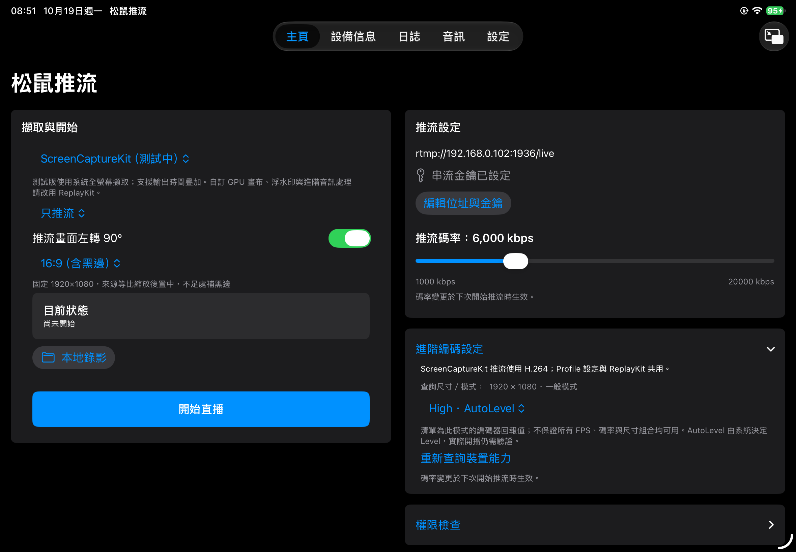

> [!WARNING]
> 說明文件不即時 由於後續更新迭代多次
>
> 文檔可能沒有更新 所以實際包含功能會有所區別

## 更新紀錄

近期更新包含：

- **擷取與錄影**：新增 ScreenCaptureKit 擷取路徑，保留 ReplayKit；提供本地錄影、分段與壓縮設定。
- **操作介面**：整併主頁、設備資訊、日誌、音訊與設定五個分頁，改善平板布局。
- **推流診斷**：補強影音管線、RTMP 連線與時間戳日誌，方便追查推流問題。

各項功能的版本、限制與驗證進度，請參閱 [完整變更歷史](Docs/ChangeHistory.md)。

## 問題應對方案

如果你遇到一些奇怪的問題 可以先看Wiki頁\
有些問題 已被發現記載在此

[常見問題處理方式 - Common Problem Solutions](https://github.com/TwhomeGH/ReplyKit/wiki)

## 螢幕擷取與本地錄影

主頁可選擇擷取來源與工作模式。

### 擷取來源

- **ReplayKit**：保留既有廣播擴展推流方式。
- **ScreenCaptureKit**：需要 iOS／iPadOS 27 或更新版本，可使用推流與本地錄影功能。

兩種來源的設定支援程度可能不同，請依所選來源的介面提示操作。

### 本地錄影

使用 ScreenCaptureKit 時，可以選擇只錄影，先確認畫面、方向與聲音，再進行直播。

錄影相關功能包含：

- 錄製品質與壓縮設定。
- 畫面方向修正。
- 分段錄製，以及結束後合併分段。
- 從本地錄影清單查看檔案資訊，並進入碼率分析。

> [!NOTE]
> 分段錄製可保留已完成的段落，降低意外中斷造成整場錄影無法使用的風險
>
> 正在寫入的段落仍可能受影響。

## 影片碼率分析

從「設備資訊」右上角的碼率分析入口，可選取影片進行檢查。

- **匯入影片**：支援從相簿或「檔案」選取。
- **查看資訊**：檢查編碼格式、解析度、幀率與碼率。
- **碼率圖表**：觀察影片不同時間點的碼率變化，協助排查品質與檔案大小問題。

### 與本地錄影的關係

碼率分析用於檢查影片的編碼、尺寸、幀率及碼率，不會修改原始影片。

ScreenCaptureKit 本地錄影另有壓縮與分段設定

這些功能屬於錄影流程，並不代表此分析頁能替任意匯入影片進行壓縮或轉碼。

## 下載與安裝

### 手動下載 IPA

請前往 [GitHub Releases](https://github.com/TwhomeGH/ReplyKit/releases)，查看版本說明並下載對應的 IPA。

### AltStore 來源

可透過 [加入 AltStore 來源](https://stikstore.app/altdirect/?url=https://raw.githubusercontent.com/TwhomeGH/ReplyKit/refs/heads/main/AltStoreTest.json) 開啟來源加入入口。

來源設定檔：[AltStoreTest.json](AltStoreTest.json)。

> [!NOTE]
> AltStore 來源與 GitHub Releases 的更新時間可能不同，安裝前請確認版本號。
> 安裝後的連線與設定同步注意事項，請參閱下方「側載用戶說明」。

## 贊助支持

本專案為個人開發，致力於提供優質的直播推流應用。為了維持持續開發與更新，我們誠摯邀請您參與贊助支持。

### 贊助管道

目前支援以下贊助方式：

- **Twitch**: [https://twitch.tv/twhomegh](https://twitch.tv/twhomegh)

### 贊助用途

您的贊助將用於：

- 維持開發與更新
- 或支持其他項目開發
- 提升技術研發能力
- 開發新功能與改善體驗

### 感謝您的支持

感謝您對本專案的贊助，您的支持是我們持續開發的重要動力。

## 側載用戶說明

主 App 與 ReplayKit 廣播擴展需要交換設定、狀態與日誌。

當安裝環境無法使用 App Group 共享容器時，會依賴 Socket 通訊。

是否能使用 App Group，取決於簽章與權限配置，不能只由「側載」判定。

若使用 ReplayKit 時出現設定未套用或診斷資料未更新，請先確認：

- 主 App 的 Socket 服務是否已啟動。
- 廣播擴展是否已連上主 App。
- 相關資料轉送與日誌選項是否已啟用。

排查時請一併提供 App 版本、擷取來源及日誌，方便確認是哪一段通訊未完成。

### Socket 轉送

在「設定 → Socket 與連線」查看本機內網 IPv4 位址、服務端口與連線狀態。

- 預設端口為 `9322`，可依需要修改。
- 外部工具連線時，請使用主 App 顯示的位址與端口。
- 若服務啟動失敗，請查看日誌中的錯誤原因，確認端口是否被占用。
- 若無法連線，請確認裝置與外部工具的網路可互通，並檢查系統的區域網路權限。

Socket 服務與日誌轉送是不同設定

需要收集廣播擴展的日誌時，請另外確認相關轉送選項已啟用。

### 畫面方向檢查

首次使用或切換擷取來源後，建議先做短時間錄影或測試推流，確認畫面方向與比例。

若畫面側轉、上下顛倒或比例不符，請檢查目前擷取來源對應的方向修正與畫布設定。

ReplayKit 與 ScreenCaptureKit 的推流、本地錄影可能使用不同的處理路徑

請分別確認結果，避免重複旋轉。

## TODO 待辦事項

集中管理於 [TODO.md](TODO.md)。

## 調試用設定

| 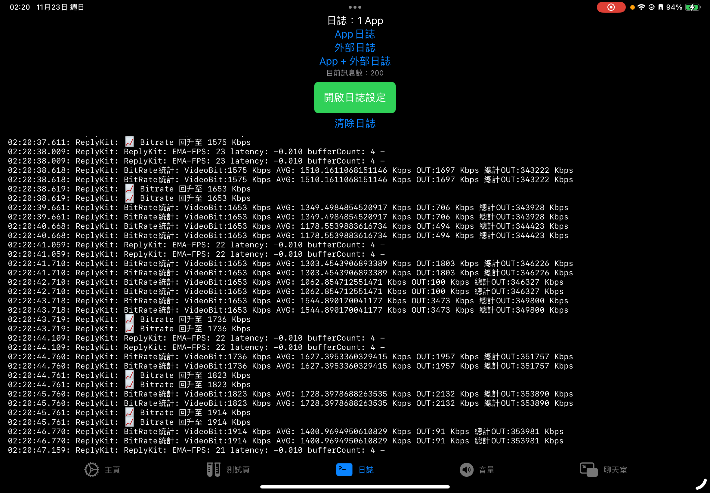 | 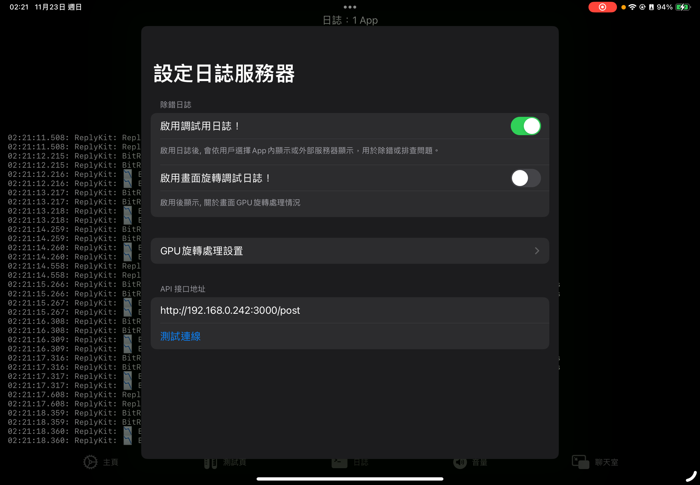 |
| --- | --- |

## GPU旋轉處理設定

| 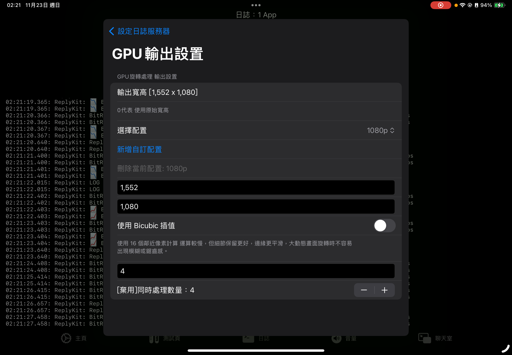 | 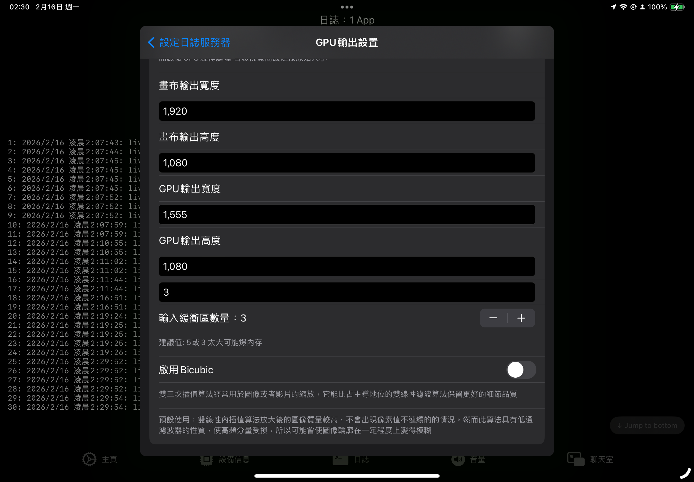 |
| --- | --- |

### 為什麼需要旋轉處理？

擷取到的影像尺寸與方向資訊，可能與預期的播放方向不同。

當輸出畫面側轉或顛倒時，可透過方向修正調整。

旋轉與畫布尺寸應一起確認，避免畫面轉正後仍出現拉伸、裁切或黑邊。

### 可設定參數

- **畫布輸出寬高**：可自定義輸出畫面的寬度與高度
- **GPU處理寬高**：可自定義GPU旋轉/縮放使用的中間處理寬高
- **配置名稱**：方便辨識用
- **選擇方向**：橫向直向
- **只改輸出寬高[畫布本身]**：開啟後GPU處理最終產物寬高與原始一致
- **輸入緩衝區數量**：太大會碰到擴展運存限制50MB 保持在3或5
- **插值方式**：使用 **Bicubic 插值**  
  - 運算較慢，但保留細節更好  
  - 對大動態畫面可減少模糊
  - 預設不使用 用線性即可

### GPU/畫布分辨率

`dstW`/`dstH` 是 GPU 中間處理尺寸，`odstW`/`odstH` 是最終畫布與 encoder 輸出尺寸。
詳細設計與 preset 對照見 [Docs/video-dimensions.md](Docs/video-dimensions.md)。

## 音訊設定

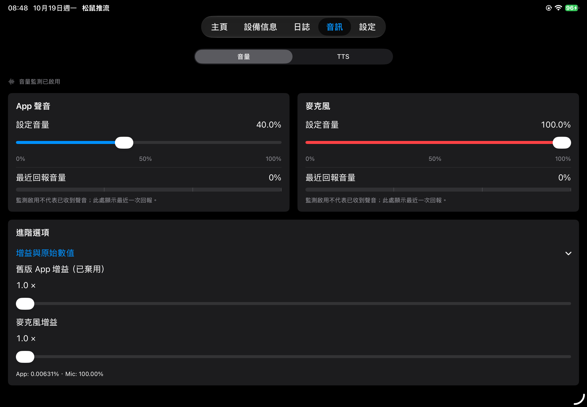

### 音訊相關功能分為

- 音訊分頁：調整 App 與麥克風音量，查看最近回報的音量。
- 設定 → 音訊處理設定：配置降噪、回音消除等處理選項。

### 降噪與回音消除

- 降噪：降低背景噪音。

- 回音消除：減少應用聲音經喇叭播放後，再被麥克風收錄的回音。

實際效果會受到收音環境、音訊路由與處理設定影響。

### 舊版 App 增益

> [!WARNING]
> 舊版 App 增益已棄用，目前保留於進階選項，預計後續移除。
>
> 一般音量調整請使用「App 聲音」卡片中的音量控制。

## 日誌與問題排查

| 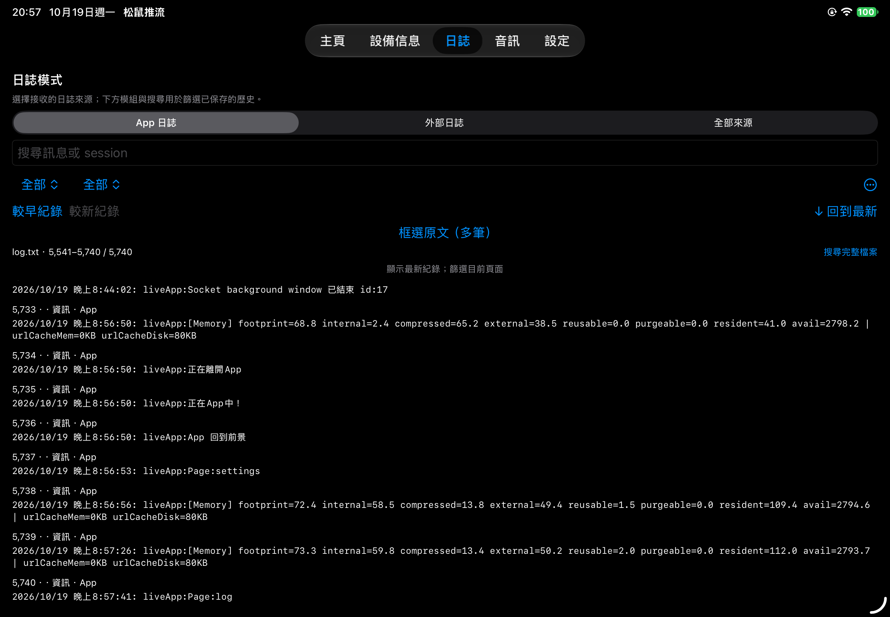 | 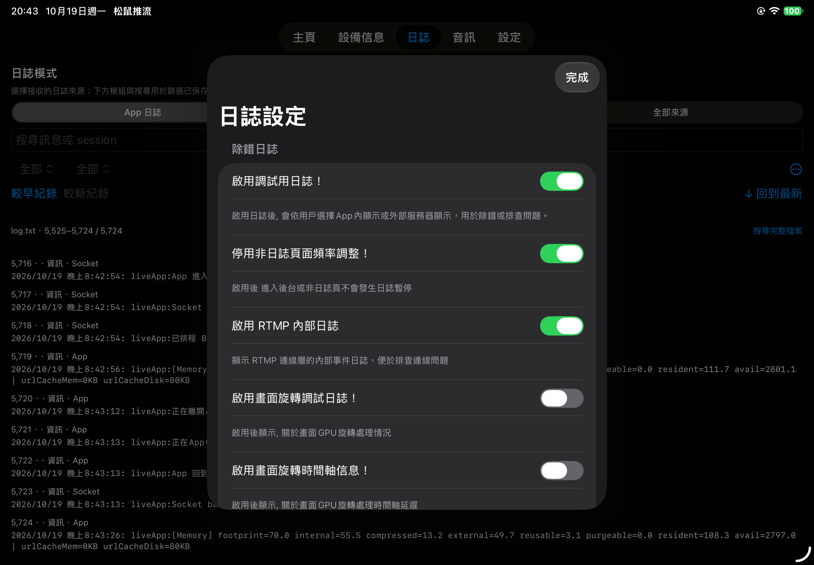 | 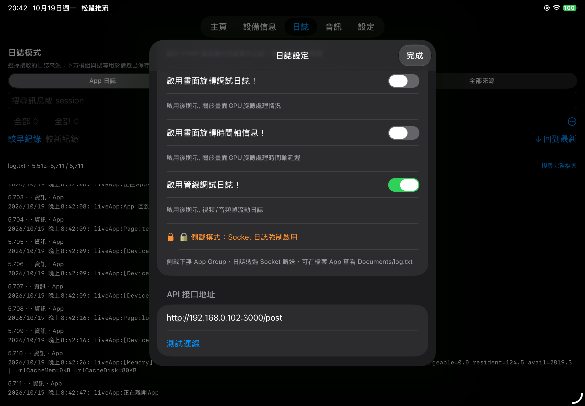 |
| -- | -- | -- |

### 查看日誌

「日誌」分頁以主 App 的 `log.txt` 為歷史資料來源，可查看較早紀錄或回到最新日誌。

頁面提供來源篩選，方便區分主 App 與外部來源的紀錄。能否看到廣播擴展日誌，取決於擴展是否已連線，以及相關記錄與轉送設定。

### 日誌設定

從「設定 → 日誌設定」，或日誌頁內的設定入口，調整記錄與轉送選項。

排查特定問題時，可啟用對應的 RTMP、畫面處理或 PiP 診斷。提供紀錄時，請註明問題發生時間、擷取來源及操作步驟。

RTMP 時間軸診斷的啟用方式與欄位說明，請參閱 [時間軸診斷文件](Docs/development/RTMP_TIMELINE_DIAGNOSTICS.md)。

### 外部日誌服務

需要將日誌送到自架服務時，可設定 POST 接收位址。一般使用不必配置此外部服務。

服務端範例：[LogServer.js](LogServer.js)。

## **設備信息**

| 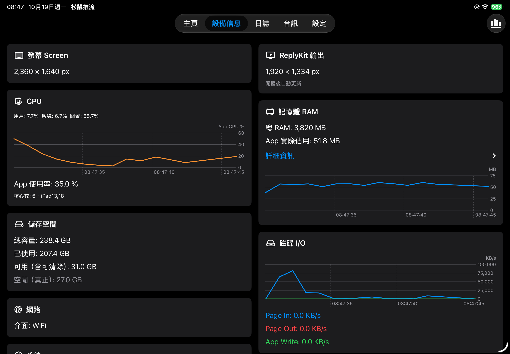 | 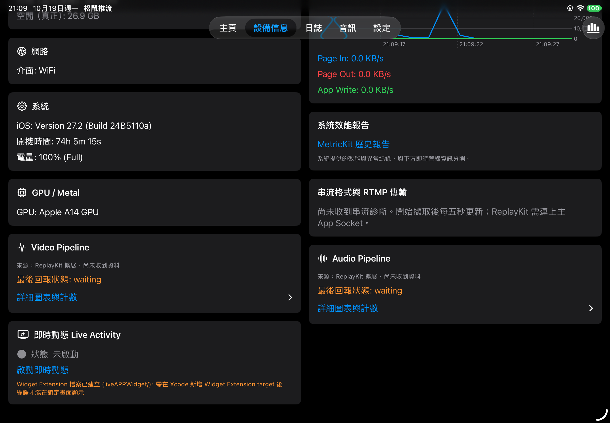 |
| -- | -- |

該頁面可以快速查看設備的重要信息，包括：

## 螢幕資訊

- 裝置原始屏幕寬高（points / pixels）
- ReplayKit 開播後得到的系統輸出解析度（如 1920×1334）

### CPU / GPU 資訊

- CPU 使用率（App 當前使用率）
- CPU 核心數
- 處理器 / GPU 名稱（如 A14 / Apple M1 GPU）

### 運行內存 RAM

以 `task_vm_info` 的 **`phys_footprint`** 為主（Jetsam 真正採計的值），並拆解來源：

- 總 RAM
- **App 實際佔用**（footprint = internal + compressed）
  - **internal**：自身配置（heap / 緩衝）
  - **compressed**：被記憶體壓縮器壓縮的部分
- **external**：檔案映射（框架 / 靜態庫 code），可被系統 evict，**不在 footprint 內、不可與 footprint 相減**
- resident / 峰值（含可回收映射，僅供對照）
- **可回收 reusable / 可清除 purgeable**：系統能直接從 App 回收的量
- 距 Jetsam 上限（`os_proc_available_memory()`）
- PIP 輸出影像池（估，3 × W×H×4）

> 只看 `resident_size` 會偏高（含可回收的檔案映射頁）；判斷記憶體壓力請看「App 實際佔用」(phys_footprint)。external 大只代表靜態連結的媒體庫（libsrt / libdatachannel / HaishinKit）code 被映射，並非 App 資料。

### 儲存空間 Storage

- 總容量顯示
- 已使用容量
- 可用(含可清除)
- 空閒 實際可使用

### 磁盤 I/O

- Page In 分頁輸入
- Page Out 分頁取出
- App Write 應用寫入

### 系統信息 System Info

- 當前iOS版本
- 設備持續運行總時間
- 電量

### 網路 Network

- 介面 是WiFI或流量
- 上行速度/下行速度 (待實現)

## 設備管線與性能報告

- MetricKit性能報告 由系統提供
- 串流格式與RTMP傳輸
- Video Pipeline 視頻管線 (由ReplyKit提供)
- Audio Pipeline 音頻管線 (由ReplyKit提供)

## **PIP子母窗口聊天室**

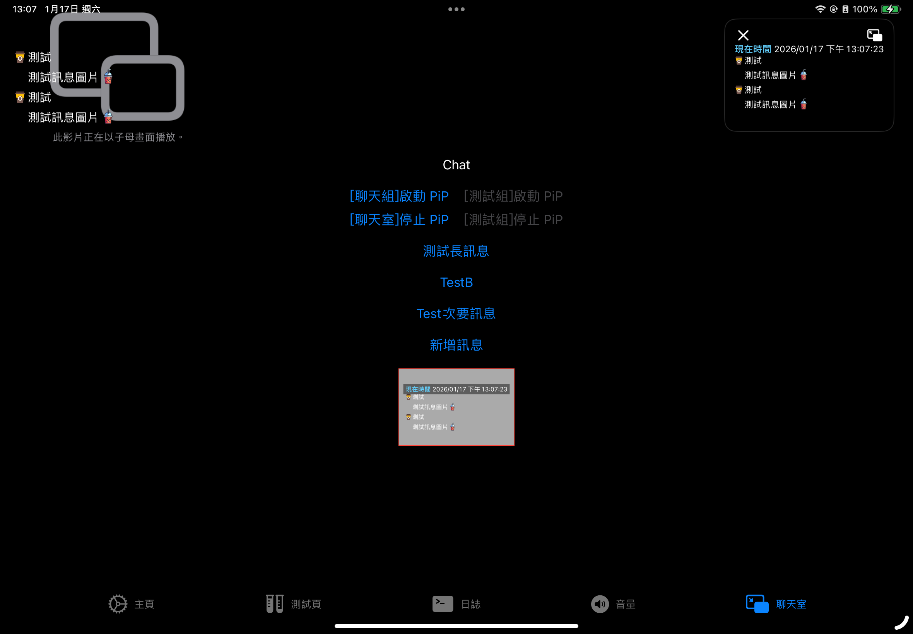

如何傳遞訊息給子母窗口

SocketApi服務端參閱以下:

- [mysocket.py](https://github.com/TwhomeGH/ReplyKit/blob/main/mysocket.py)
- [TikTok or Twitch訊息服務端](https://github.com/TwhomeGH/TTWChatMessageServer)

## Socket 傳輸說明

### 1. 連線資訊

- 協議：TCP

- 伺服器 IP / HOST：請填寫App端設備使用的地址

- PORT：9322

### 2. 傳輸格式

每次發送的資料為 JSON 格式，並以換行符號 \n 作為結束符。

### 範例訊息

```json
{
    "type": "StreamMessage",
    "user": "userName",
    "message": "message_text",
    "img": "https://img.icons8.com/?size=100&id=L8HgZUgz2jWS&format=png&color=000000",
    "giftImg": "https://img.icons8.com/?size=100&id=124077&format=png&color=000000",
    "isMain": true,
    "userNum": 1234,
    "userList": ["A", "B", "C"]
}
```

### 欄位說明

| 欄位 | 類型 | 說明 |
| -- | -- | -- |
| type | String | 消息類型，固定 "StreamMessage" |
| user | String | 使用者名稱 |
| message | String | 訊息內容 |
| img | String | 顯示用戶頭像用 使用圖示 URL |
| giftImg | String | 贈送禮物圖示 URL |
| isMain | Boolean | 是否為主要消息 (true/false) |
| userNum | Number | 可選參數，觀眾數；若有提供，會顯示在 PiP「直播中」標籤旁邊 |
| userList | `Array<String>` | 可選參數，觀眾清單；目前會先接收保留，未提供也不影響既有功能 |

補充說明

- `userNum` 與 `userList` 都是可選欄位，舊格式只傳 `isMain` 也能正常使用
- 若 `userNum` 沒有傳入，PiP 不會額外顯示觀眾數標籤
- `userList` 目前先保留給後續功能使用，現階段不會直接顯示在 PiP 畫面上

---

### 對子母畫面 發送直播開始/結束訊息

直播開始

```json
{
    "type": "StreamStarting",
}
```

  | 欄位 | 類型 | 說明 |
  | -- | -- | -- |
  | type | String | 接口消息類型 |

---

直播結束

```json
{
    "type": "Ended",
    "Message":"StreamEnded"
}
```

  | 欄位 | 類型 | 說明 |
  | -- | -- | -- |
  | type | String | 接口消息類型 Ended代表結束 |
  | Message | String | 顯示在子母用的結束訊息 使用預設填 StreamEnded |

### 3. 發送方式（Python 範例）

```python
import socket
import json
import time

HOST = "伺服器IP"
PORT = 9322

def create_connection():
    while True:
        try:
            s = socket.socket(socket.AF_INET, socket.SOCK_STREAM)
            s.connect((HOST, PORT))
            print("Connected to server")
            return s
        except Exception as e:
            print("Connection failed, retrying in 3s...", e)
            time.sleep(3)

s = create_connection()

while True:
    message = {
        "type": "StreamMessage",
        "user": "user3333",
        "message": "Hello World",
        "img": "https://img.icons8.com/?size=100&id=L8HgZUgz2jWS&format=png&color=000000",
        "giftImg": "https://img.icons8.com/?size=100&id=124077&format=png&color=000000",
        "isMain": True,
        "userNum": 1234,
        "userList": ["A", "B", "C"]
    }

    try:
        s.sendall((json.dumps(message) + "\n").encode("utf-8"))
        print("Message sent")
    except BrokenPipeError:
        print("Broken pipe! Reconnecting...")
        s.close()
        s = create_connection()
        s.sendall((json.dumps(message) + "\n").encode("utf-8"))

    time.sleep(5)  # 每 5 秒發送一次
    
```

### 4. 長連線建議

為了提升訊息傳輸的穩定性和效率，建議使用 長連線模式：

1. 保持連線活躍

    - 在建立連線後持續使用同一個 socket 發送多條訊息，避免每次發送都重新建立連線。

    - 適合頻繁推送資料的場景，例如直播聊天室、持續訊息流。

2. 自動重連

    - 伺服器可能因超時或網路波動斷開連線，這時程式會捕獲 BrokenPipeError 自動重連，確保訊息不中斷。

3. 範例程式特點

    - 使用 create_connection() 函數安全建立 TCP 連線。

    - 在無窮迴圈中發送訊息，每次發送前捕獲斷線錯誤。

    - 支援自動重連後繼續發送訊息。

4. 其他建議

    - 長連線需要注意網路穩定性與錯誤處理，避免程式崩潰。

5. 心跳訊息

    > [!WARNING]
    > **已移除／不再需要** — 此功能適用於 v11.4.2 之前（永久連線架構）的版本。
    > 自 v11.4.2 起 Socket 改為按需連線（on-demand），連線短暫存活，不再需要心跳保活。
    > 以下說明僅供仍使用舊版架構的參考。

    為了保持連線活躍，防止伺服器判定連線閒置而斷開，客戶端可以定期發送心跳訊息

    設計上是每60秒會清理一次 所以建議每30秒或在50秒時發一次維持

    - 發送內容：只需發送一個 JSON，type 設為 "heartbeat"，並以 \n 結尾即可。

    - 伺服器行為：收到心跳訊息後會重置 idleTimer，確保連線不被自動關閉。

    欄位說明

    | 欄位 | 類型 | 說明 |
    | -- | -- | -- |
    | type | String | 消息類型，固定 "heartbeat" |

    Python 範例

    ```python
    import socket
    import json
    import time

    HOST = "伺服器IP"
    PORT = 9322

    def create_connection():
        while True:
            try:
                s = socket.socket(socket.AF_INET, socket.SOCK_STREAM)
                s.connect((HOST, PORT))
                print("Connected to server")
                return s
            except Exception as e:
                print("Connection failed, retrying in 3s...", e)
                time.sleep(3)

    s = create_connection()

    while True:
        heartbeat = {
            "type": "heartbeat"
        }

        try:
            s.sendall((json.dumps(heartbeat) + "\n").encode("utf-8"))
            print("Heartbeat sent")
        except BrokenPipeError:
            print("Broken pipe! Reconnecting...")
            s.close()
            s = create_connection()
            s.sendall((json.dumps(heartbeat) + "\n").encode("utf-8"))

        time.sleep(30)  # 每 30 秒發送一次
    ```

## **背景記憶體管理**

iOS 的 Jetsam 機制在記憶體緊張時會終止背景 App。本專案在進入背景時自動釋放非關鍵資源以降低被終止機率。

| 背景釋放項目 | 檔案 | 回收量 |
| ------------- | ------ | ------- |
| PiP 圖片快取 | `PIPContent.swift` | ~20MB |
| PiP pixel buffer pool | `PIPService.swift` | ~9MB |
| PiP render timer + pipeline | `PIPService.swift` | ~1MB |
| PiP 訊息圖層 | `PIPContent.swift` | ~2-5MB |
| LogModel 日誌緩衝 | `liveAPPApp.swift` | ~300KB |
| LogView 文字緩衝 | `ContentView.swift` | ~6-7MB |

**預期：** 背景常駐記憶體從 ~90-100MB 降至 ~55-65MB，Jetsam 終止風險顯著降低。**保留資源：** SocketServer（log 管線）、PiP 渲染管線（若子母畫面 active）。詳見 `Docs/replykit-core-fixes-summary.md` §11。
